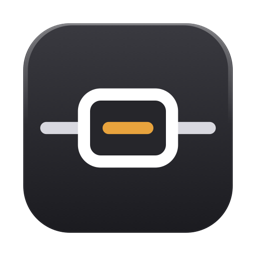
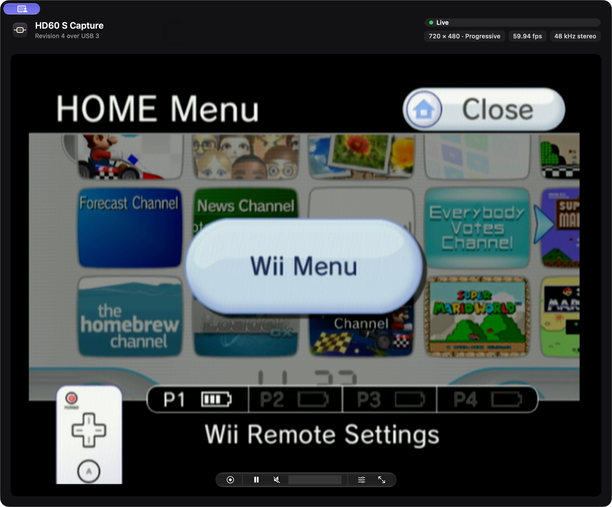
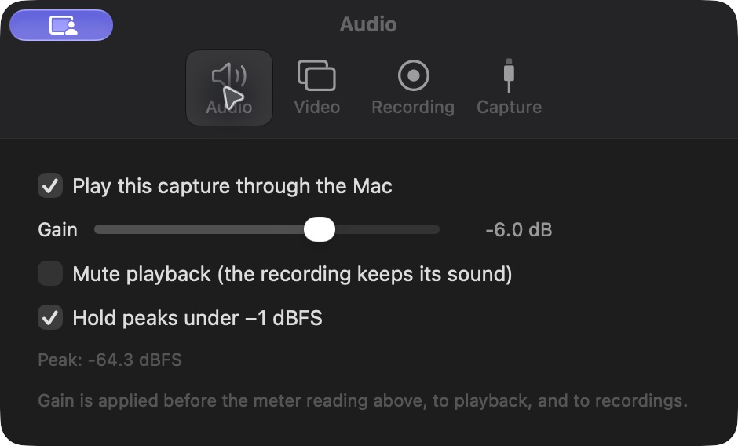
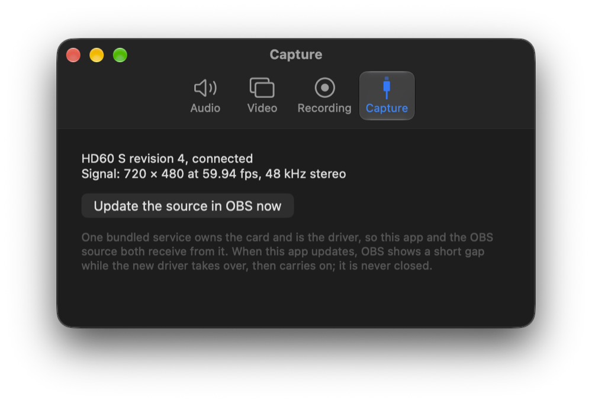

<p align="center">
  
</p>

<h1 align="center">HD60 S Capture</h1>

<p align="center">
  A native macOS app and OBS source for the Elgato HD60 S, on Apple silicon.<br>
  <a href="https://github.com/koels/hd60s-capture/releases/latest">Download the latest release</a>
</p>

---

The Elgato HD60 S is a USB 3 capture card: HDMI in from a console, video and
sound out over USB. This project talks to the card directly over USB, with no
kernel extension and no Elgato software, and gives you two ways to use it:

- **HD60 S Capture**, a Mac app that shows the console's picture with its sound,
  records it, and goes full screen.
- **HD60 S Native**, a source for OBS Studio 33 that brings the same picture and
  sound into your scenes.

Both can use the card at the same time, because one small background service
owns the card and hands frames to each of them.

<p align="center">
  
</p>

> **Made with AI.** The app, the USB driver, the OBS source and this README were
> written with an AI coding assistant (Claude), directed and tested by a person
> on real hardware: an HD60 S revision 4 capturing a Wii, through this app and
> OBS 33. The protocol comes from Doug Brown's GPL-2.0 Linux driver, credited
> below. Read the code before trusting it with anything that matters, and expect
> the rough edges of a driver that has had one tester.

## What it does

- Live preview with the card's HDMI audio, played through your Mac.
- Recording to H.264 and AAC QuickTime movies at the input's own resolution and
  frame rate, using the Apple silicon hardware encoder.
- Full screen, with a control bar that fades out when the pointer is still.
- Audio gain, mute and a peak limiter, with a live level meter.
- An OBS source with the same picture and sound, plus scaling, frame-rate and
  color options of its own.
- Clear status screens instead of a black box: no card, no signal, card in use,
  and starting up, each saying what to do next.
- Recovery on its own when the HDMI source changes mode, for example a Wii
  loader launching a game.
- Updates to the app, the driver and the OBS source, signed and checked,
  without closing OBS.

## Supported hardware

| Card | USB ID | Status |
|---|---|---|
| HD60 S revision 4 | `0fd9:0076` | Built and tested on this one |
| HD60 S revisions 1 to 3 | `0fd9:004f`, `0fd9:005e`, `0fd9:0074` | Tried with the same protocol; untested |

If you own an older revision, an issue saying whether it works, either way, is
the most useful thing you can send. If it does not answer like revision 4, the
app and OBS say so plainly, and nothing is sent to the card beyond the setup
commands revision 4 takes.

Inputs: progressive video up to 1920 × 1080. 1080p at 59.94 fps has been confirmed working; 720p is expected to work.
Interlaced formats remain untested/unknown and are currently rejected by the
driver. HDCP-protected sources are not captured.

Needs macOS 13 or later on Apple silicon, and a USB 3 port.

## Install

1. Download `HD60-S-Capture-<version>.zip` from the
   [latest release](https://github.com/koels/hd60s-capture/releases/latest) and
   unzip it.
2. Move **HD60 S Capture** into your Applications folder.
3. Open it. Preview and sound start on their own once the card is plugged in
   and the console is on.

The app is not notarized by Apple, so the first time you open it macOS will
refuse. Open **System Settings → Privacy & Security**, scroll to the message
about HD60 S Capture, and choose **Open Anyway**. You only do this once;
updates installed by the app do not need it again.

If OBS is on your Mac, the app installs the OBS source for you, into your own
OBS plugins folder. No password is needed and no system setting is changed.

## Using the app

The control bar over the picture has three groups: record and its timer; pause,
sound on or off and the input level; settings and full screen. Double-click the
picture for full screen, and press Escape to leave it.

Settings (in the app menu, the slider icon in the bar, or **Command-comma**) has four sections:

| | |
|---|---|
| **Audio** | Play the capture through this Mac, gain, mute playback, the −1 dBFS peak limiter, and a live peak reading. |
| **Video** | How the picture fills the window (fit, fill or stretch), and whether the control bar stays visible in full screen. |
| **Recording** | Where movies are saved (`~/Movies/HD60 S Capture/` by default) and the quality, standard or high. |
| **Capture** | What the card and the signal are doing right now, and a button to update the OBS source. |

<p align="center">
  
  
</p>

Your choices are remembered between launches. Mute affects playback only; a
recording keeps its sound.

## Using it in OBS

1. In OBS, **Sources → Add → HD60 S Native**.
2. Video and sound come in together; you do not need a separate audio source.
3. Use **Transform → Fit to Screen** to fill the canvas.

Hiding the source with the eye icon releases the card for other apps, and
showing it takes the card back. Turn that off per source with **Release the
card while this source is hidden**. Hearing the capture is an OBS setting:
audio monitoring is off until you turn it on for the source.

Double-click the source to open its properties. Changes apply live, without
restarting the stream:

- **Output resolution:** match input, 640 × 480, 720 × 480, 1280 × 720 or
  1920 × 1080. Scaling resizes the received frame; it does not change the
  console's HDMI mode or add detail.
- **Frame-rate limit:** match input, or a cap from 23.976 to 60. It drops
  frames and never invents them. The recording or stream frame rate is still
  set in **OBS Settings → Video**.
- **Pixel format:** YUY2 as received, NV12, or BGRA.
- **Color space and range:** automatic by default, with Rec. 601, Rec. 709 and
  a limited or full range override for test patterns that need one.
- **Audio:** −30 to +6 dB gain (−6 dB to start), mute, and a −1 dBFS limiter.
- **Refresh input and audio levels:** the current HDMI mode, the raw peak since
  the last refresh, and a count of near-full-scale samples before gain.

For hardware encoding, choose **Apple VT H.264 Hardware** or **Apple VT HEVC
Hardware** in **OBS Settings → Output**; encoding belongs to the OBS output,
not the source.

To show your scene as a camera in Discord or a video call, use OBS's own
**Start Virtual Camera**. It carries video only, not the HDMI sound.

## Updates

Updates come from this repository's
[GitHub Releases](https://github.com/koels/hd60s-capture/releases), through
[Sparkle](https://sparkle-project.org). Every release is signed, and the app
refuses anything whose signature does not match the public key it ships with,
`packaging/appcast-key.pub`.

- **With the app open,** it checks once a day, and **Check for Updates** is in
  the app menu.
- **With only OBS open,** the OBS source checks when OBS starts and every six
  hours after. It runs the installed app with no window, which updates itself
  and exits, then updates its own OBS source file.

**OBS is never closed for an update.** The driver lives in the background
service, not in the OBS source, so when a new version takes over the card OBS
shows a short gap in the picture and carries on with the new driver. The
updated OBS source file itself is read the next time OBS starts.

## How it works

```
Console ──HDMI──▶ HD60 S ──USB 3──▶ hd60s-service ──shared memory──▶ HD60 S Capture.app
                                                                 └──▶ OBS source
```

`hd60s-service` is the driver. It is the only process that opens the card: it
initializes it, reads the USB stream, splits it into frames and audio, and
publishes them in shared memory under `/tmp/hd60s-<uid>/`. The app and the OBS
source are clients that read from it, so pausing or closing one never
interrupts the other. Whichever client starts first launches the service, and
it exits about 20 seconds after the last client leaves.

The service restarts capture on its own when the signal is lost, when the
console changes mode, and when the USB stream stops arriving while the card
still reports a valid mode. Each build carries a number, and a client that
finds an older service running replaces it with the newest one installed.

More detail: [shared capture](docs/shared-capture.md),
[the app](docs/standalone.md), and [protocol notes](docs/protocol.md).

## Building from source

Needs the Xcode command line tools and OBS 33 in `/Applications/OBS.app`.

```sh
./tools/fetch-deps.sh   # OBS 33.0.0 headers, SIMDe 0.8.2, Sparkle 2.10.1
make bundle             # the app with the OBS source inside it
make test
```

The app is built to `build/HD60 S Capture.app`. `make install` copies just the
OBS source into your OBS plugins folder instead. Override `OBS_APP`, `OBS_SRC`
or `SIMDE_SRC` if yours live elsewhere; OBS headers must match the installed
OBS major version.

The version lives in one place, the `VERSION` file. The Makefile turns it into
both the bundles' version and the service's build number (0.4.20 is 420), and
building outside the Makefile stops with an error rather than guessing.

A rebuilt app that is already running keeps the old code. The window notices
the newer copy on disk and offers to relaunch.

### Releasing

Maintainer only, since it needs the private signing key in the login Keychain
(account `hd60s-capture`):

```sh
# bump VERSION, commit, then:
tools/release.sh        # build, test, sign, publish the GitHub release
tools/check-versions.sh # after updating: app, both OBS source copies and the running driver agree
```

The app is ad-hoc signed with a designated requirement on its bundle ID, which
is what lets one build accept the next without a paid certificate; the EdDSA
signature is what proves an update is genuine. Distributing without the
**Open Anyway** step would need an Apple Developer ID and notarization.

## Diagnostics

```sh
make probe                                                   # list the card's USB descriptors
./build/hd60s-capture --seconds 10 --frame build/frame.yuy2  # capture directly, without the service
python3 tools/preview.py build/frame.yuy2 build/frame.png --width 720 --height 480
```

Close the app and OBS first: the direct capture tool needs the card to itself.
Run these from a normal Terminal, since a sandboxed shell can block USB access.
The service logs to `/tmp/hd60s-<uid>/service.log`; the OBS source logs under
`~/Library/Application Support/obs-studio/logs` with the prefix
`[HD60 S Native]`.

## Tested, and not yet

Tested on an HD60 S revision 4 capturing a Wii at 720 × 480, 59.94 fps, with
48 kHz stereo:

- Preview, sound, recording and full screen in the app.
- The OBS source in OBS 33, alongside the app at the same time.
- Automatic recovery when a Wii loader launches a game.
- Updates from GitHub with the app closed and OBS open, without OBS restarting.
- Parser, audio processing, status screen and shared-memory tests, run with
  AddressSanitizer and UndefinedBehaviorSanitizer (`make test`, `make test-shared`).

Also confirmed: 1920 × 1080 progressive at 59.94 fps with 48 kHz stereo.
720p is assumed working, pending a separate hardware test. The window follows
the incoming video aspect ratio without cropping.

Not yet tested or not implemented: revisions 1 to 3,
interlaced input, analog audio, more than one card, long-run audio and video
drift, and calibrated color accuracy.

## Credits and license

GPL-2.0-only; see [LICENSE](LICENSE).

The USB protocol and control flow follow Doug Brown's
[hd60s-linux-driver](https://github.com/dougg3/hd60s-linux-driver) (commit
`34621f7`, copyright 2026 Doug Brown). The macOS transport, parser, service,
app and OBS integration were written for this project; no code from
adam8113/hd60s-arm64 is used. OBS headers are GPL. SIMDe and Sparkle carry
their own licenses.
